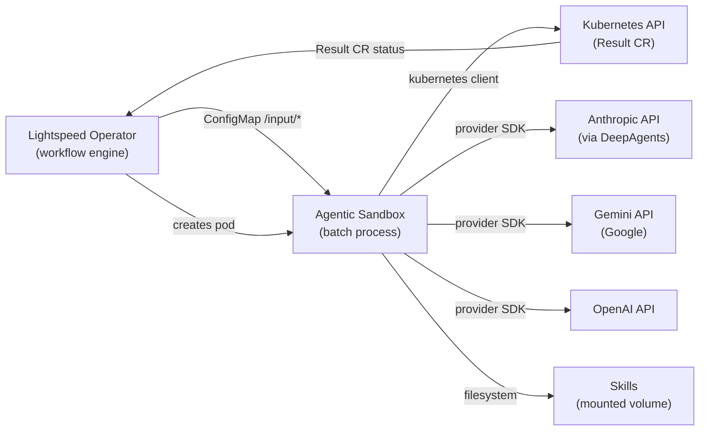
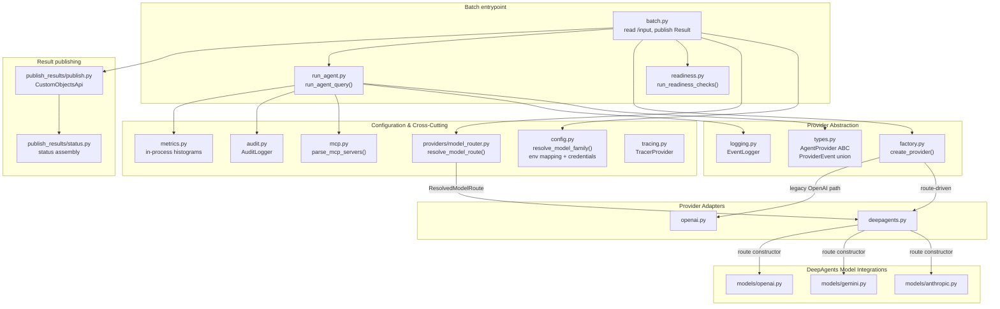
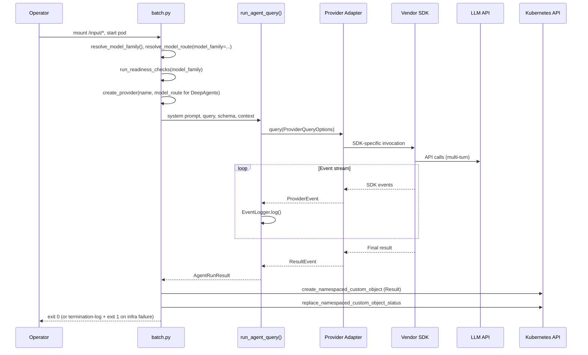
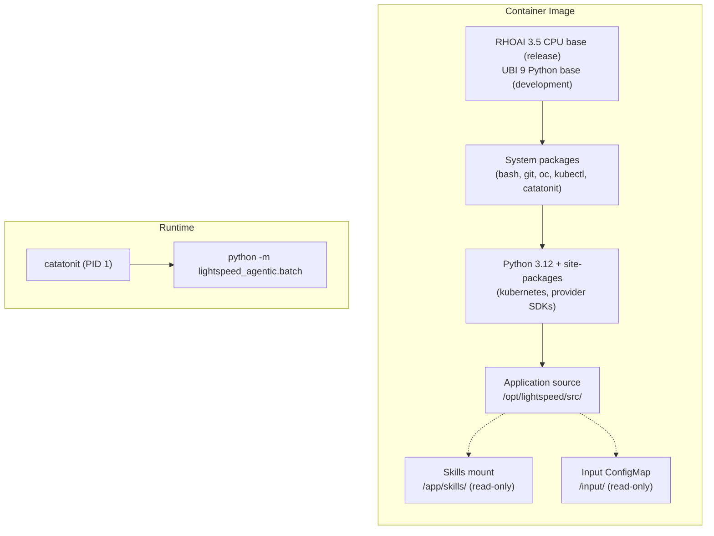

# Architecture

The lightspeed-agentic-sandbox is a multi-provider agent runtime for OpenShift Lightspeed. It runs as a **one-shot batch process** inside ephemeral Kubernetes pods: the operator mounts input files, the sandbox runs the agent, publishes a Result CR via the Kubernetes API, and exits.

## System Context

The sandbox sits between the operator (workflow engine) and the LLM provider APIs. Each pod processes one AgenticRun step and is disposable.

There is **no HTTP server** in the sandbox — no FastAPI, no `/health`, `/ready`, or `/v1/agent/run`.

## Internal Architecture

## Batch Run Flow

Result CR lifecycle uses the **`kubernetes` Python client** (`CustomObjectsApi`), not `oc` subprocesses. The image still ships `oc` and `kubectl` for **agent tool execution** (delegated to provider SDKs).

## Provider Adapter Design

Each adapter is a thin wrapper. The SDK owns tool execution, skill discovery, and multi-turn orchestration. Adapters map SDK events to normalized `ProviderEvent` objects and extract token usage.

| Harness | Model integrations | Structured Output | Skills | Tools |
|---|---|---|---|---|
| DeepAgents | Anthropic direct, Bedrock, and Vertex; Gemini on Vertex; native OpenAI and custom/vLLM endpoints via `langchain-openai` | Tool-free second pass without reasoning; native OpenAI uses strict JSON schema, compatible endpoints preserve the supplied schema | `/skills/` virtual `CompositeBackend` route when skills exist | `LocalShellBackend` (default) + `/skills/` `FilesystemBackend` route + MCP tools |

Batch resolves the model family once and reuses it for routing and credential
readiness. Anthropic, Vertex/Google, and native/custom OpenAI return a `ResolvedModelRoute` with
the selected model, typed constructor parameters, telemetry identity, and
structured-output method. The factory injects this route into `DeepAgentsProvider`;
the provider creates fresh main, inspection-classifier, and output-shaping models
through it. Only the main model receives query reasoning. Anthropic constructors
live in `providers/models/anthropic.py`; the Vertex Gemini constructor lives in
`providers/models/gemini.py`; native OpenAI uses `providers/models/openai.py` to
construct `ChatOpenAI(use_responses_api=True)` with resolved credentials. These
integrations retain lazy SDK imports and shared TLS. Native OpenAI is selected
only for hosting `openai` with no endpoint override or an HTTPS URL whose hostname
is `api.openai.com`; a non-HTTPS URL with that hostname is rejected. Endpoint
precedence and normalization are defined in
[configuration rule 3a](.ai/spec/what/configuration.md). Custom/vLLM endpoints use
`ChatOpenAI(use_responses_api=False)` through the `openai-compatible` route, with
raw schema mode and a non-strict schema wrapper. Azure uses the shared DeepAgents
harness with native Azure clients, API-key or Entra ID auth, and version-aware
Chat Completions/Responses schema handling. Vertex/OpenAI is unimplemented pending OLS-4472; the legacy adapter and dispatch are removed. The overall single-harness migration
remains partially implemented; live parity and telemetry compatibility review are
still required.

DeepAgents exposes skills at virtual `/skills/` paths and relies on its SDK
middleware to provide the corresponding host paths to shell commands. Scripts
run through native `execute`; dependent setup/check commands must share one shell
call. Artifacts use writable `HOME/.deepagents` storage. See the
[skills-route decision](.ai/spec/decisions/0002-sdk-native-skills-route.md)
for path mapping and execution limits.

## Container & Deployment

The sandbox ships as a container image built with Konflux hermetic builds (dependencies prefetched, no network during build). Release builds use RHOAI 3.5 CPU base images configured in `.konflux/build.args`; non-hermetic developer builds default to UBI 9 Python 3.12 images.

The container runs as non-root user `agent`. `catatonit` is PID 1. The batch module reads `/input/`, runs the agent, publishes the Result CR, and exits — no listener port.

## Key Decisions

- **One provider per pod:** Selected at startup through `config.resolve_model_family()` and `providers.model_router.resolve_model_route()`. Anthropic, Vertex/Google, native/custom OpenAI, and Azure receive an explicit DeepAgents model route; Vertex/OpenAI is unimplemented pending OLS-4472.

- **Thin adapters:** Provider modules map SDK events to a normalized union type; they do not re-implement SDK behavior.

- **Lazy SDK imports:** The factory uses lazy imports so the base package loads without any vendor SDK installed.

- **Kubernetes API for Result CRs:** `publish_results/publish.py` uses the `kubernetes` Python client — not `oc create` / `oc patch`. Inside a pod (`KUBERNETES_SERVICE_HOST` set), authentication MUST use in-cluster config only; if that fails, publish fails and kubeconfig MUST NOT be consulted. Outside a cluster (local dev/tests), kubeconfig MAY be used when in-cluster config is unavailable.

- **Hermetic builds:** Python wheels and RPMs are lockfile-prefetched. `oc`/`kubectl` are copied from Red Hat image stages for agent tools, not for sandbox infrastructure.
